# PC Vitals

A lightweight Windows 11/10 system monitor that puts your PC's vitals **right on the taskbar**. CPU, GPU, memory
and network usage, temperatures and power draw are always in view. Hover any item for a detail card, or click it
for a dashboard of every sensor in your machine.

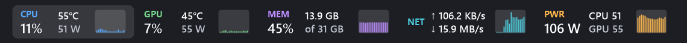

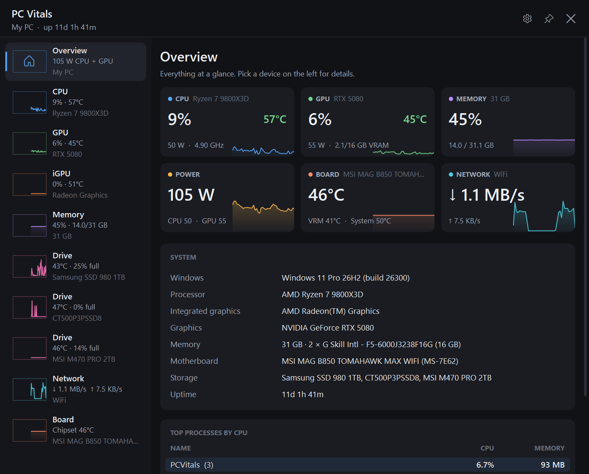

| CPU page | GPU page (light theme) |
|---|---|
| 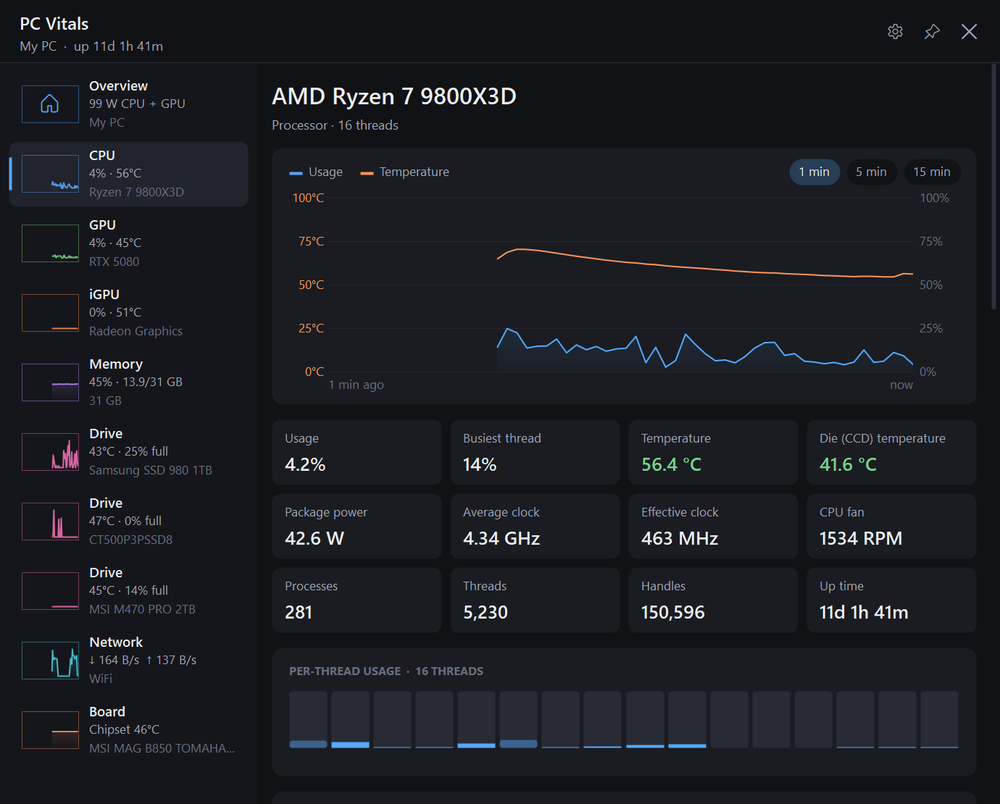 | 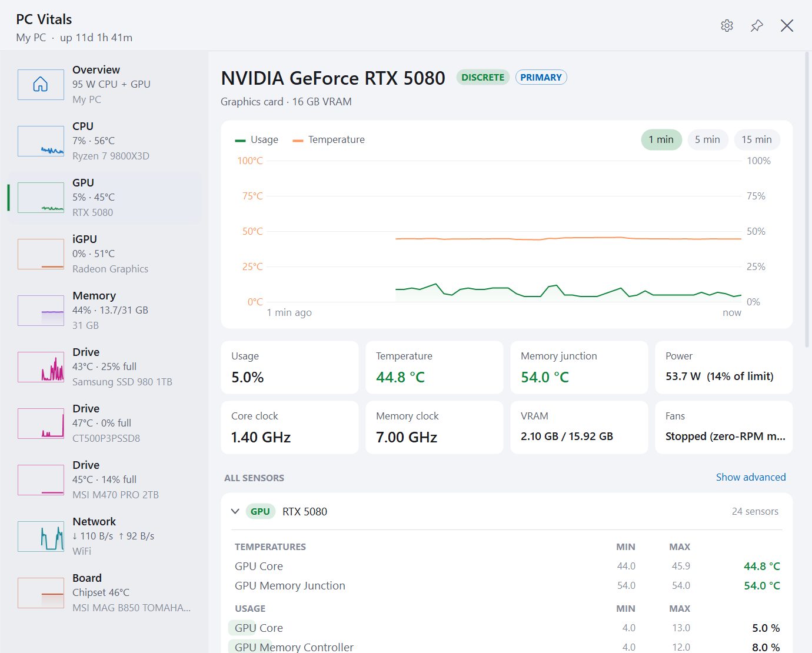 |
| **Memory page (AMOLED theme)** | **Hover cards** |
| 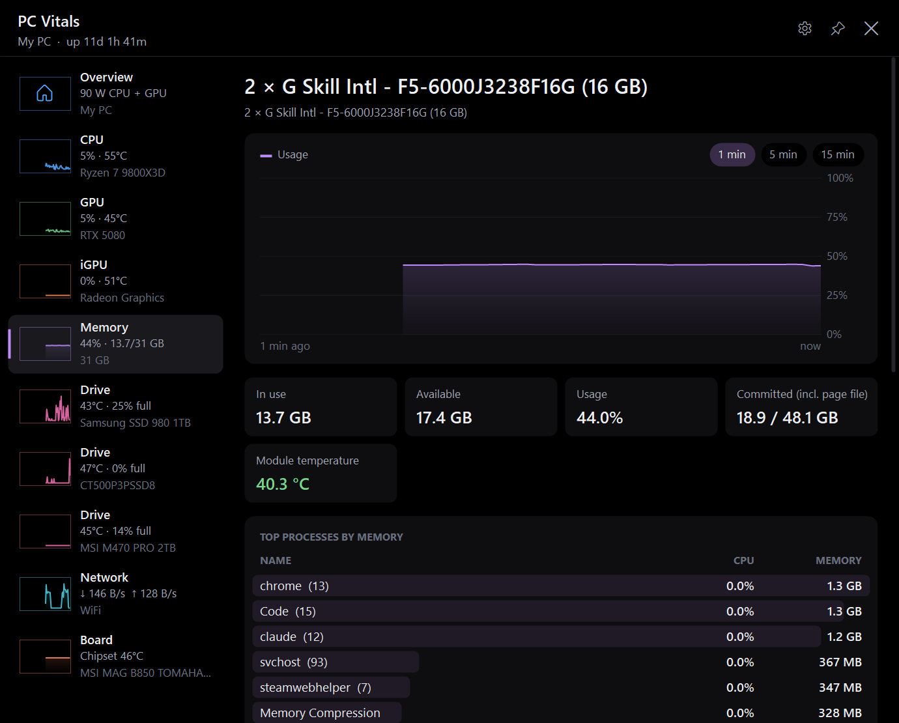 | 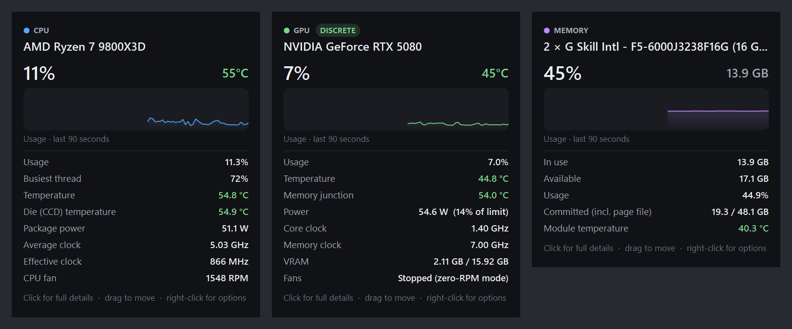 |

## Features

### On the taskbar
- **Labelled readouts** with mini history graphs, drawn next to the clock.
  - Default layout: **CPU** (usage, temperature, power), **GPU** (usage, temperature, power), **MEM**, **NET**.
  - Optional items: **PWR** (CPU + GPU draw), **iGPU** (the second GPU), **BOARD** (chipset/VRM temps), **SSD**,
    **BAT** (charge, charging/discharging watts, time left; switched on automatically on laptops).
  - Rename, reorder and toggle items; choose Small, Medium or Large; drag the strip sideways to move it.
  - Optionally shown on every display's taskbar.
- **Never covers your apps.** The strip measures the gap between the Start button / app icons and the tray, and
  if it doesn't fit it hides graphs, then shrinks, then hides trailing items. Settings tells you what it did.
- Follows the taskbar's light/dark theme, steps aside for fullscreen games and video, and supports auto-hiding
  taskbars (optionally as a floating bar).
- **Hover cards** with the full device name (e.g. *NVIDIA GeForce RTX 5080 · Discrete*), a graph and key details.
- **Any sensor on the taskbar**: pin any reading (a fan, a drive, the GPU hot spot, a voltage) with Settings →
  Taskbar → Add sensor…, or from the dashboard. Each shows its value with its min and max, a mini graph, and a hover
  card with the session average. A sensor whose device is unplugged stays in place and shows `--`.
- **Optional tray icons** (label + number, or number only) for CPU/GPU temperature and usage, RAM and power.

### Desktop panel
- **A floating panel of readings** to leave on screen: numbers, bars, ring gauges and history graphs, with a clock
  and date. Switch it on in Settings → Desktop panel or from the tray icon's menu.
- **Nine ready-made layouts**: Compact, Gaming, Graphs, Gauges, Sidebar, Full system and three for a portrait case
  screen (below). Readings for devices your PC doesn't have are left out.
- **Three portrait layouts for a case screen** (made for a 6-inch 720 × 1600 display such as the Lian Li
  Lancool 207 Digital, used as a second monitor with "Fill the display" on): *Case screen: glance* (a big clock,
  four ring gauges and big numbers, readable across the room), *dashboard* (clock and date, usage and temperature
  gauges, history graphs, memory, power and network) and *everything* (every reading). They are 9:20 tall, stay
  that shape when readings your PC lacks are left out, and use a soft radial background with see-through cards.

  <p>
    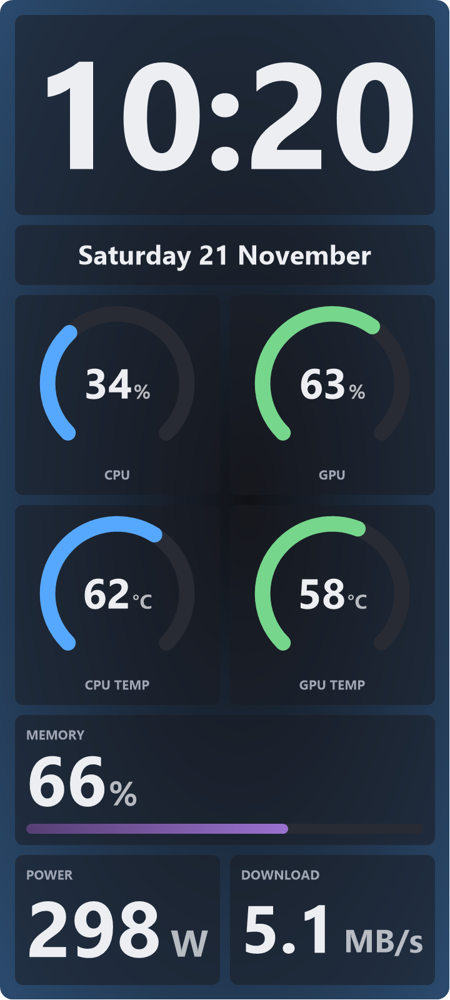
    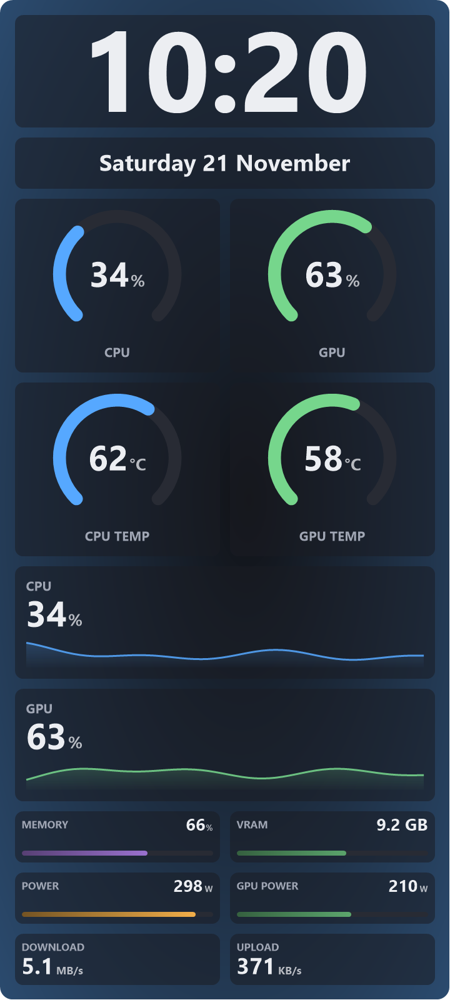
    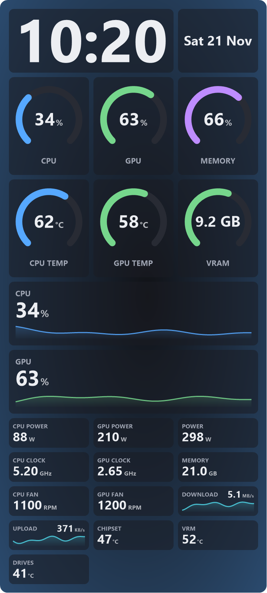
  </p>
- **Layout editor** (right-click the panel → Edit layout): drag tiles from a palette onto the panel, move and
  resize them, and choose for each one:
  - **any reading**: CPU, GPU, memory, network, drives, battery… or any sensor in the dashboard;
  - **what it shows**: label, number, bar (solid or LED segments, across or upwards), gauge (ring, semicircle,
    full circle or segments) and history graph (1, 5 or 15 minutes), in any combination;
  - decimals, unit, text size, font, colours, and **colour steps** (e.g. amber from 70, red from 85).
  - Also: **text** with readings in it (`CPU {cputemp} · GPU {gputemp}`), a **clock/date** in any format,
    dividers and **pictures**.
  - Tiles snap to a grid, or switch to **free placement** to put them anywhere (with snapping guides and layering).
  - Undo/redo, duplicate, keyboard editing (arrows move, Shift+arrows resize, Tab moves between tiles).
- **Several panels**, each with its own layout, display and placement, and an optional **background picture**.
- **Export and import layouts** as files, pictures included, to share them or move them to another PC (readings
  are matched by name there).
- **On top of windows, among them, or on the desktop** behind them (it comes back into view with Windows+D).
  Lock it so clicks go through, hide it during fullscreen games and videos, and pick the display.
- **Fill a display**: covers a whole monitor, sized to fit, for a small screen mounted in or on the case.
- **Your colours**: background (solid to fully see-through), labels, numbers, and bars/graphs, or follow the app
  theme. Temperatures turn amber and red when hot.
- **Background gradients**: linear (in any of eight directions) or radial, from the background colour to a second
  colour of your choice.
- **Background picture** from Settings → Desktop panel → Background (or the layout editor), filled, fitted,
  stretched, tiled or centred. An **animated GIF** plays on the panel (drawn by the graphics card, with Motion on):
  it is decoded once, kept as GPU frames (at most 64 MB: pictures smaller than the panel stay at their own size, and
  very large ones drop every other frame or shrink) and paced by the frame rate. With Motion off, or with classic
  CPU drawing, it shows its first frame.
- **Tile backgrounds**: solid, **see-through** (the background colour, gradient or picture shows through the
  cards behind the readings) or off. Choosing a picture switches solid cards to see-through.
- **Tile borders**: an outline around each tile card: none (the default), **subtle** (the theme's border colour) or
  **accent** (each reading's own colour: CPU blue, GPU green...), 1 to 4 px thick, following the corner rounding
  and the panel's size.
- **Motion and effects** (Settings → Desktop panel → Motion and effects), drawn by the graphics card:
  - **Smooth** motion: numbers count, and bars, gauges and colours glide to each new reading.
  - **Full** motion: graphs also scroll continuously instead of stepping once per reading.
  - A **moving background**: the gradient slowly turns (linear) or drifts (radial).
  - **Glow** around bars, gauges and graph lines, and **shaded bars and gauges** (dim at the empty end, full
    colour at the reading).
  - **30 or 60 fps** while something moves. A still panel draws nothing between readings.
  - **Pause when away** (on by default, per panel): while the screen is locked or the display is off, the panel
    stops drawing altogether and lets go of the graphics card, then redraws the moment you unlock or the display
    comes back. Readings keep being collected. A dimmed display still counts as visible.
  - Turn off "Draw with the graphics card" to go back to the classic CPU drawing (no animations).
- **Scenes** (Settings → Desktop panel → Scenes): a panel can switch to another panel's layout while the PC is
  busy, and back when it calms down: a quiet look for the desktop and big numbers for gaming, with nothing to touch.
  Make a second panel with the layout you want (it can stay hidden), then pick it under "Switch layout when busy".
  Choose what busy means (GPU usage above, CPU usage above, or a fullscreen game or video on the main display)
  and the threshold (50 to 80 %). It switches after 5 seconds of busy and back after 15 seconds of calm, so it
  doesn't flicker. The panel keeps its own display, position, size, mode and lock; only the tiles, grid and look change.
- Drag it to move it, click a reading to open its page in the dashboard, right-click it for options. Any sensor
  can be added from its menu in the dashboard ("Add to the desktop panel").

### Dashboard
- **Device rail** with live thumbnails (CPU, each GPU, memory, each drive,
  network, motherboard, battery/PSU when present). Click a taskbar item to jump straight to its page.
- **Big history graph** for 1, 5 or 15 minutes, 1 or 24 hours (one-minute averages), or 7 or 30 days (saved
  history, with the minimum-to-maximum range shaded behind the average), with temperature overlaid on its own
  axis and a hover crosshair that shows the date and time.
- **Saved history**: one-minute averages, minimums and maximums of the headline readings and your favourite and
  pinned sensors are kept on disk for 30 days by default (7, 30 or 90), so the graphs continue across restarts.
  About 1–2 MB a day; days older than a week are folded into 5-minute periods. Export any period as CSV, at
  1-minute, 5-minute or hourly resolution. Turn it off or delete it in Settings → General.
- **Stat tiles** per device: clocks, power vs. limit, hot spot / memory junction, VRAM, fan state, drive wear and
  lifetime writes, DIMM temperatures, battery wear and capacity, process/thread/handle counts and more.
- **Drive health and space**: each drive shows its letters (C:, D:) and free space per volume, and a
  Good / Caution / Bad health verdict from its SMART data (spare blocks, wear, reallocated, pending and unreadable
  sectors, integrity errors), with the reasons in plain words. Free space per volume can be pinned, graphed and
  alerted on like any sensor, and "drive health" is an alert preset.
- **Wi-Fi and latency**: the Network page shows the Wi-Fi network, signal and link speed (optionally the signal on
  the NET item), and, if you turn it on, ping latency, jitter and loss to your router or a host you choose.
- **Top processes** by CPU, memory or GPU (grouped by app, with a per-app GPU column), and a per-thread CPU load
  graph.
- **Keyboard and screen reader friendly**: Tab / Shift+Tab move through everything clickable, Enter activates,
  and every control has a name for screen readers (in Settings too).
- **Every sensor** LibreHardwareMonitor can read, with min, session average and max. Noisy ones (per-engine D3D
  load, power-connector pins, memory timings) stay hidden until you ask for them.
- **Sensor options**: click or right-click any sensor (or press the menu key) to favourite it, rename it (the new
  name is used everywhere), hide it, show it on the taskbar, or reset its min, max and average.
- **Overview page** with your favourite sensors and system information: Windows version, CPU, GPUs, memory
  modules, motherboard, drives.

### Settings
Sidebar navigation and setting cards, with a live preview of the taskbar strip as you edit.

- **Search** (Ctrl+F): type in the box under the app name to find any setting by its name, description, section
  or choices, including common other words ("animation" finds Motion, "color" finds colours, "fps" finds Frame
  rate, "wallpaper" or "image" finds Background picture). **Show** (or Enter for the first result) opens its page and outlines it.

| Taskbar | Appearance |
|---|---|
| 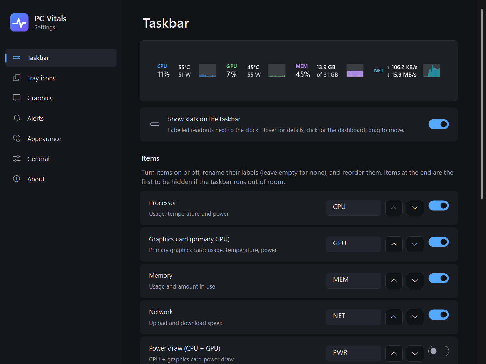 | 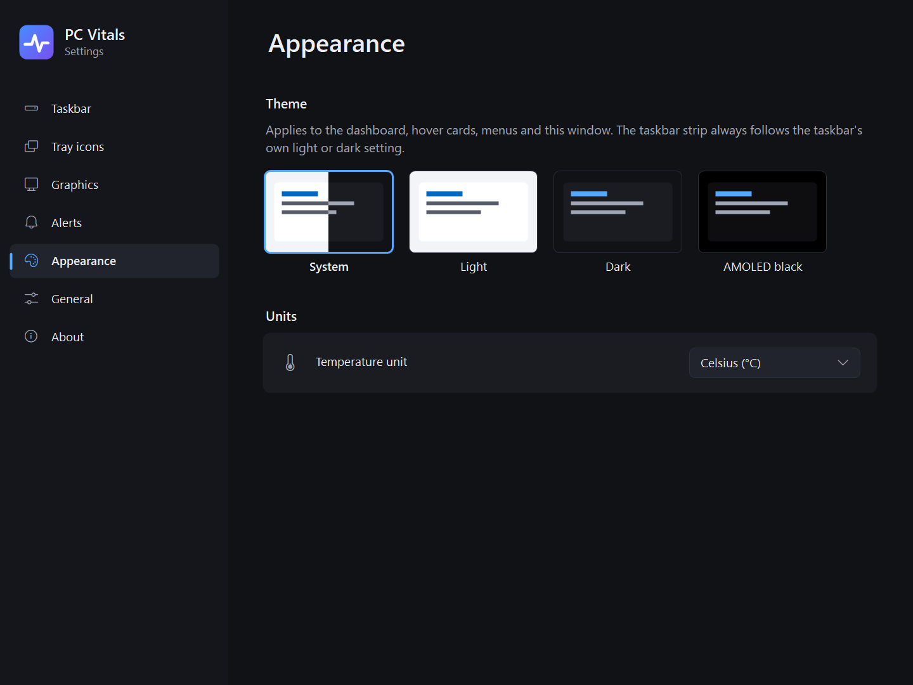 |

- **Themes**: System (follows Windows), Light, Dark, and AMOLED black.
- **Temperature unit**: °C or °F.
- **Alerts on any sensor**: when a reading stays above or below your limit for a while (CPU or GPU temperature,
  memory use, or any sensor: "fan below 300 RPM", "SSD above 60 °C"), show a notification (click it to open that
  device in the dashboard), play a sound, and/or run a program of your choice. Programs run as you, without
  administrator rights, unless you tick "as administrator". Repeats at most once per interval you choose while the
  reading stays there; the last 100 alerts are listed in Settings → Alerts. Add one from Settings or from a
  sensor's menu in the dashboard.
- **Keyboard shortcut** to open the dashboard from anywhere (off by default).
- **Primary GPU** choice on multi-GPU systems, with discrete/integrated labels.
- **Start with Windows** without a UAC prompt at each sign-in (a scheduled task with highest privileges).

No network access unless you turn on ping (Settings → General; off by default, and it pings your router unless
you name another host). No telemetry. Settings live in `%APPDATA%\PCVitals\settings.json`, saved history in
`%LOCALAPPDATA%\PCVitals\history` (one file per day; it never leaves your PC).

## Requirements

- Windows 10 or 11, x64. On Windows on ARM (Snapdragon) it runs under x64 emulation in the limited mode
  only: the PawnIO driver and LibreHardwareMonitor's hardware access are x64-only, so CPU temperature/power,
  motherboard and fan sensors aren't available.
- [.NET 8 Desktop Runtime](https://dotnet.microsoft.com/download/dotnet/8.0) (to run), or the .NET 8 SDK (to build)
- **Administrator rights** for CPU temperature/power, motherboard, chipset, fan, DIMM and drive sensors. The app
  asks once at startup; if you decline it runs in a limited mode (GPU, load, memory and network still work).
- The **[PawnIO](https://pawnio.eu/) driver** for CPU and motherboard sensors. LibreHardwareMonitor uses it in
  place of the old WinRing0 driver, which Windows Defender now blocks. If you already use a recent
  LibreHardwareMonitor, FanControl or similar tool, it is probably installed. PC Vitals checks for it: if it's
  missing you get a one-time notification, a banner in the dashboard and its status in Settings → About, each
  with a link to install it. Restart PC Vitals afterwards.

### "Windows protected your PC"

The released exe isn't code-signed (signing certificates cost money), so Windows SmartScreen may warn about an
unrecognised app the first time you run it. Click **More info → Run anyway**. If you'd rather not, build it
yourself from source with the commands below; it's the same code.

## Build and run

```bash
git clone https://github.com/<you>/PCVitals.git
cd PCVitals
dotnet publish -c Release -r win-x64 --self-contained false -p:PublishSingleFile=true -o publish
publish\PCVitals.exe
```

For a single exe that doesn't need the .NET runtime installed (much larger), use `--self-contained true`.

Run the unit tests (taskbar fit rules, settings migration, GPU detection, formatting):

```bash
dotnet test tests/PCVitals.Tests
```

### Using it

| Action | Result |
|---|---|
| Hover a taskbar item | Detail card for that component |
| Click a taskbar item | Open the dashboard on that item's page (click the same item again to minimise it) |
| Click the tray icon | Open the dashboard, or bring it to the front |
| Close the dashboard window | It hides; PC Vitals keeps running in the tray (exit from the tray menu) |
| Drag the taskbar strip sideways | Move it (Settings → Taskbar → Reset puts it back) |
| Right-click the strip or tray icon | Menu: dashboard, settings, refresh rate, start with Windows, exit |
| Ctrl+↑ / Ctrl+↓ in the dashboard | Previous / next device |
| Tab / Shift+Tab, Enter in the dashboard | Move between and activate buttons, devices and tiles |
| Click or right-click a sensor in the dashboard | Favourite, rename, hide, show on the taskbar, reset min/max |

On Windows 11, new tray icons start in the overflow (`^`) menu. The taskbar strip doesn't need this, but you
can drag the PC Vitals icon onto the taskbar if you like.

## Performance

PC Vitals is meant to sit in the background all day, so it is built for a small footprint. Measured on a
Ryzen 7 9800X3D + RTX 5080 + 3 NVMe drives, 1-second refresh, running as administrator:

| | |
|---|---|
| CPU, steady state | **~1.7–2.7 % of one core** (≈0.1–0.2 % of a 16-thread machine, including the UI) |
| Private memory (Task Manager "Memory") | **~35–47 MB** as admin, ~23 MB without admin |
| Sensor poll per refresh | **~15–19 ms** |
| Process start → UI | **~80 ms** (ReadyToRun); first full reading ~1.2 s |

How it stays light:

- **NVIDIA's NVML library is kept out of the app.** Initialising NVML commits about 20 MB that it never gives
  back, and its PCIe throughput query blocks for about 45 ms per poll. The taskbar only needs board power from
  it, so PC Vitals computes that from NVAPI's power percentage (already polled) times a per-card
  watts-per-percent ratio. The ratio is learned once by a short-lived helper process and is accurate to about
  0.2 W on average. While the dashboard is open, a helper process streams PCIe throughput and exact power; its
  memory goes away when the dashboard closes.
- **Garbage doesn't pile up.** .NET sizes its youngest-generation budget from the CPU's L3 cache; on a 96 MB-L3
  X3D chip that meant 40+ MB of garbage between collections. A 64 MB heap hard limit (the live heap is ~3–11 MB)
  caps it at about 5 MB. Drive discovery's one-off ~40 MB of
  allocations are decommitted right after it finishes.
- **The two slowest NVIDIA reads are trimmed** on background polls (measured on an ASUS RTX 5080):
  - NVAPI's power topology, which the board-power estimate is made from, cost about 7–10 ms of processor time per
    read. It is now read every 2 s (every poll while the dashboard is open), and the last value stays on screen in
    between. The estimate's accuracy is unchanged (~0.3 W mean error).
  - The 12VHPWR connector pin sensors (ASUS ROG Astral cards) are read over I²C only while the dashboard is open, or
    when one of them is pinned, alerted on or on a panel. Reading them on every poll cost about 3.6 ms of processor
    time and 4 ms of waiting.
  - Together: the card's background update fell from ~18 ms to ~8 ms of processor time per second, and the app's
    steady-state CPU from ~1.8 % to ~1.25 % of one core (non-admin `--bench`, 1 s refresh).
- **Per-engine Direct3D counters** (about 20 per GPU) are only read while the dashboard is open. The headline
  GPU load comes from NVAPI/ADL.
- **Demand-driven polling**: drive SMART data, DIMM SPD (over SMBus), the motherboard sensor chip and the
  non-primary GPU are read every 3–30 s unless something on screen needs them every second.
- **Deferred discovery**: drives, USB/HID controllers, PSUs and batteries are probed after the first reading,
  so the taskbar fills in sooner.
- **Draw only on change**: the strip and tray icons re-render only when what they show changes.
- **Desktop panel on the GPU**: Direct2D through DirectComposition, on its own render thread. Labels, tracks, tile
  cards and pictures are drawn once and kept on the GPU. Text layouts, gradients and shapes are reused from frame
  to frame, and graph lines are tessellated once per reading and only moved while they scroll. Measured on a
  1336×1220 panel with every tile changing each second, as a share of one core: **0.7 %** with motion off,
  **~4 %** with smooth motion, **~6.5 %** with full motion at 60 fps (the classic CPU drawing is 1.7 % with no
  animation). The graphics driver adds roughly 50 MB of private memory once a panel is on screen; turning off
  "Draw with the graphics card" avoids it. An animated GIF background redraws only when its picture changes frame
  (at most the panel's frame rate): a 30-frame, 25 fps GIF on a 720×1600 panel measured about 1-3 % of one core, and
  the frames add roughly the GIF's decoded size (up to the 64 MB cap) in graphics memory.
- **Nothing drawn while away**: when the session is locked or the display is off (notifications from Windows, on
  a message-only window), panels stop drawing and release the GPU surface, and resume with a full redraw on
  return. A graphs panel with full motion, a moving gradient and 60 fps measured **~3.1 %** of one core in
  use against **0.0 %** while away (10 s each, test harness). Sensor polling is unaffected.
- **Cheap process list**: top processes come from one `NtQuerySystemInformation` call per refresh (no
  per-process handles), and only while a page that shows them is open.
- **Efficient when idle, on time under load**: the sensor poller runs in Windows' efficiency mode (EcoQoS) so it
  doesn't raise clocks on an idle PC. Under a full load (a render, a compile) Windows let such a thread wait
  seconds for a turn, so readings froze until PC Vitals had the focus. The poller now leaves efficiency mode, at
  above-normal priority, as soon as the CPU is 75 %+ busy or a poll starts late, and returns after ten calm polls.
  With all 16 threads at 100 %, readings went from 22 of 28 arriving (gaps up to 6 s) to 27–28 of 28.
- **Startup and footprint**: ReadyToRun (no JIT warm-up), invariant globalization (no ICU), non-concurrent
  workstation GC with `ConserveMemory`, and the working set is trimmed after startup and whenever the dashboard
  or settings close.

## Diagnostics

```bash
PCVitals.exe --dump sensors.txt              # every sensor and its value (also: Settings → About → Save sensor report)
PCVitals.exe --bench bench.txt               # startup, per-device poll cost, CPU and memory
PCVitals.exe --memprofile mem.txt            # private memory per library / sensor group
PCVitals.exe --memprofile mem.txt pipeline   # the same for the app's actual lean path
PCVitals.exe --bench-history hist.txt       # write, compact and load a synthetic month of saved history
PCVitals.exe --alert-selftest alert.txt     # run one alert rule on live readings, including its "run a program" action
PCVitals.exe --taskbar-report tb.txt         # taskbar geometry and how wide the strip would be
PCVitals.exe --preview docs                  # render the README screenshots
PCVitals.exe --write-icon PCVitals.ico      # regenerate the app icon from the logo drawing
PCVitals.exe --replace                       # replace a running instance with this build
PCVitals.exe --no-elevate                    # skip the admin prompt (limited mode)
```

Unexpected errors are written to `%APPDATA%\PCVitals\error.log`. The same log notes, once, if a sensor poll fails
or one of the memory/CPU optimisations can't be applied (for example after a LibreHardwareMonitor update), so a
quiet loss of efficiency doesn't go unnoticed. The library version is pinned for that reason.

Found a bug? Please [open an issue](../../issues/new/choose) and attach the sensor report from Settings → About.

## Project layout

| File | What it does |
|---|---|
| `Core/HardwareService.cs` | Owns LibreHardwareMonitor, polls on a background thread, builds snapshots and summaries |
| `Core/Readings.cs` / `Core/SensorCatalog.cs` | Readings with stable sensor ids, saved sensor references, and sensor lookup and search |
| `Core/HistoryStore.cs` | Recent and one-minute history, by sensor id with aliases for the headline series |
| `Core/HistoryArchive.cs` / `Core/HistoryRecorder.cs` | Saved history: day files, series map, loading, clean-up, and the background writer |
| `Core/HistoryCsv.cs` / `Core/HeadlineSeries.cs` | CSV export of saved history, and names for the headline series |
| `Core/Alerts.cs` | Alert rules, the engine that decides when they go off, and the alert history |
| `Core/Drives.cs` / `Core/Network.cs` | Drive volumes and health rules; Wi-Fi status and the opt-in ping |
| `Core/NvmlFeed.cs` | Helper process that streams NVML readings while the dashboard is open |
| `ProcessStats.cs` / `GpuProcessUsage.cs` | Top processes by CPU, memory and GPU |
| `Vitals.cs` | Turns a snapshot into display items (labels, values, detail rows) shared by every view |
| `TaskbarWidget.cs` / `StripFit.cs` | The per-pixel-alpha layered window drawn on the taskbar, and its fit rules |
| `tests/PCVitals.Tests` | Unit tests (xUnit) |
| `HoverCard.cs` | Detail card shown when hovering a taskbar item |
| `DesktopPanel.cs` / `PanelRenderer.cs` | The desktop panel window, and its classic GDI+ drawing (also used for previews and the still layer) |
| `GifBackground.cs` | Animated GIF backgrounds: frame decoding (with the memory cap) and the GPU frame player |
| `Scenes.cs` | Scenes: when a panel switches to its busy layout (with hysteresis), and merging that layout with the panel's window options |
| `Away.cs` | Pause when away: the locked / display-off state and the hidden window that hears about it from Windows |
| `GpuSurface.cs` / `GpuPanelRenderer.cs` | The panel's GPU path: Direct2D + DirectComposition surface, the animating renderer and its render thread |
| `DashboardForm.cs` / `DashboardView.cs` | The dashboard window (owner-drawn) |
| `SettingsForm.cs` / `SettingsControls.cs` | Settings window and its toggle, card, dropdown and preview controls |
| `SensorDialogs.cs` | The sensor picker and the rename prompt |
| `HistoryDialogs.cs` | The history export dialog |
| `AlertEditor.cs` / `AlertActions.cs` | The alert rule editor; notification text, sounds, and starting programs without admin rights |
| `TrayContext.cs` | App lifetime, tray icons, menu, alerts and wiring |
| `AppSettings.cs` | Settings persistence and the start-with-Windows task |
| `Theme.cs` | Light, dark and AMOLED palettes, and value formatting |
| `Hotkeys.cs`, `Native.cs`, `Gfx.cs`, `TrayIconRenderer.cs` | Global shortcut, Win32 interop, drawing helpers, tray icons |

## License

MIT, see [LICENSE](LICENSE). LibreHardwareMonitor is used under its own MPL-2.0 licence.

## Credits

- Sensor access by [LibreHardwareMonitor](https://github.com/LibreHardwareMonitor/LibreHardwareMonitor)
  (MPL-2.0), using the [PawnIO](https://pawnio.eu/) driver.
- Direct2D, DirectWrite and DirectComposition bindings by [Vortice.Windows](https://github.com/amerkoleci/Vortice.Windows) (MIT).
